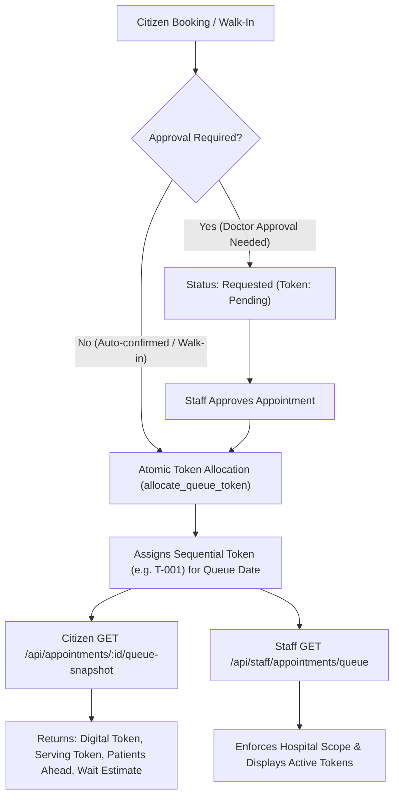

# Audit & Phase 1 Implementation: Appointments & Digital Queue Module

**Author:** Vikash (Appointments & Tokenless Queue Lead)  
**Branch:** `vikash/appointments-queue`  
**Base Commit:** `076b933`  
**Project:** Pulse AI Prototype  
**Date:** 27 October 2026  

---

## 1. Executive Summary & Audit of Existing Implementation

Prior to coding Phase 1, an end-to-end audit was conducted across the Express backend, React frontend, Supabase migration files, and automated tests.

### 1.1 Existing Architecture
* **Frontend:** Built with React 19, TypeScript, and Vite. Contained `AppointmentsPage.tsx` for citizen booking and `HospitalQueuePage.tsx` for hospital staff queue management.
* **Backend:** Express 5 REST API with routes at `/api/appointments` and `/api/staff/appointments`.
* **Database & Migration State:** The appointment migration `20261026000100_appointments_demo.sql` was intentionally deferred and unapplied. 
* **Runtime Data State:** The appointment service ran entirely in-memory via arrays in `appointmentService.ts`. All bookings, slots, and events reset upon server restart.

### 1.2 Problems & Vulnerabilities Identified
1. **Contradictory "Tokenless" Messaging:** The UI explicitly declared *"This page does not issue a token number"*. In physical hospital OPD clinics, calling patients solely by name causes patient anxiety, crowding, and privacy violations. An alphanumeric digital token (e.g., `T-001`, `T-002`) was required.
2. **Missing Atomic Concurrency Token Counter:** There was no per-day, per-department atomic sequence mechanism to prevent duplicate token assignment under concurrent bookings or walk-ins.
3. **No Private Citizen Queue Snapshot API:** Citizens had no dedicated endpoint to check their real-time place in line. Fetching the queue exposed all patient appointments for that department.
4. **Unscoped Staff Authorization:** Staff checks validated role flags or user IDs via `APPOINTMENT_STAFF_USER_IDS` but did **not** enforce hospital boundaries. Any authorized staff user could view and mutate queues for any hospital across the system.
5. **Lack of Repository Abstraction:** Service logic directly mutated in-memory arrays with no persistence adapter boundary to switch safely to Supabase.

---

## 2. Phase 1 Architecture & Implemented Solutions

### 2.1 Database Migration: `20261027000100_queue_tokens.sql`
A new migration was created at `supabase/migrations/20261027000100_queue_tokens.sql` (isolated and unapplied to the live database):
* **`public.queue_counters`:** Maintains atomic counters per `(facility_id, department_id, queue_date)` tracking `last_token_number` and `serving_token_number`.
* **Appointment Tracking Columns:** Added `queue_date`, `token_number`, `digital_token`, and `called_at` to `public.appointments`.
* **Token Uniqueness Constraint:** `appointments_facility_queue_token_unique` guarantees duplicate tokens cannot exist for the same facility, department, and calendar date.
* **Atomic Concurrency Function:** `public.allocate_queue_token(...)` uses PostgreSQL row-level locks (`INSERT ... ON CONFLICT DO UPDATE`) to safely assign tokens under high concurrency without race conditions.
* **Serving Token Advancement:** `public.advance_serving_token(...)` updates the active serving token when staff calls a patient.
* **Realtime Publication Config:** Registers `queue_counters` into `supabase_realtime` publication for Phase 2 live push updates.
* **Row-Level Security:** Read-only for authenticated callers; mutations restricted to service-role functions.

### 2.2 Persistence Layer & Repository Pattern
Introduced `AppointmentRepository`:
* **`InMemoryAppointmentRepository`:** Used for isolated unit testing and local demo execution. Tracks sequential token counters and serving pointers per department and day.
* **`SupabaseAppointmentRepository`:** Database-backed adapter. Checks for missing schemas (`42P01`, `PGRST205`) and throws explicit `503 APPOINTMENT_SCHEMA_NOT_READY` errors instead of silently failing or faking persistence.
* **Backward Compatibility:** `AppointmentService` preserves its synchronous API, ensuring 100% of existing tests continue passing without requiring broad refactoring.

### 2.3 Digital Token Allocation Rules
Integrated atomic digital token allocation into `AppointmentService`:
1. **Auto-Confirmed Bookings:** Immediately allocated a sequential token (`T-001`, `T-002`, etc.) scoped to `(hospitalId, departmentId, queueDate)`.
2. **Approval-Required Bookings:** Created with status `requested` and `tokenNumber: null`. The token is allocated atomically when hospital staff confirms the visit.
3. **Walk-Ins:** Created with status `waiting` and immediately allocated the next sequential token for today's queue date.
4. **Rescheduling on the Same Date:** Preserves the patient's existing digital token.
5. **Rescheduling to Another Date:** The token on the previous date is retired and forfeited (never reused). A new token is allocated for the new calendar date.
6. **Cancellations & Misses:** The token number is retained on the record for auditability, but the counter is never decremented. Cancelled tokens are excluded from the active queue and never reassigned.

### 2.4 Authenticated Queue Snapshot API
Added `GET /api/appointments/:id/queue-snapshot` in `backend/src/routes/appointments.ts`:
* **Patient Ownership:** Strictly enforces `patient_user_id = auth.uid()`. Cross-user access returns `404 APPOINTMENT_NOT_FOUND`.
* **Zero Patient Data Leakage:** Returns only the caller's token, the current serving token, calculated patients ahead, wait estimate, and refreshed timestamp. Does not expose other patients' names or clinical information.
* **Staff Queue Information:** Added `currentServingToken`, `currentServingDigitalToken`, and active queue count to `GET /api/staff/appointments/queue`.

### 2.5 Hospital-Scoped Staff Authorization
Enhanced `appointmentAccess.ts`:
* Evaluates `app_metadata.appointment_hospital_ids`, `app_metadata.allowed_hospital_ids`, or `app_metadata.appointment_all_hospitals`.
* Staff restricted to Hospital A attempting to read or update visits for Hospital B receive `403 STAFF_HOSPITAL_FORBIDDEN`.

### 2.6 Frontend UX Integration
* **`frontend/src/api/appointments.ts`:** Added `QueueSnapshot` type and `getAppointmentQueueSnapshot(...)`.
* **`AppointmentsPage.tsx`:** Displays digital token badges (`Token: T-00X`) in appointment details, list items, and an active queue card showing *Now Serving* and *Patients Ahead*. Updated messaging to reflect digital queue tracking.
* **`HospitalQueuePage.tsx`:** Added prominent "Now Calling / Serving Token" banner, digital token badges on queue cards, and updated assisted registration notes.

---

## 3. Verification & Test Ledger

All tests passed cleanly with zero regressions across all workspaces.

| Test Suite | Tests Run | Result | Notes |
| :--- | :---: | :---: | :--- |
| `test/appointmentQueue.test.ts` | 11 | **Passed** | New Phase 1 suite: tokens, snapshots, ownership, staff scoping, persistence error handling. |
| `test/appointmentService.test.ts` | 23 | **Passed** | Existing appointment lifecycle and validation tests. |
| `test/scenarioService.test.ts` | 11 | **Passed** | Hospital scenario simulation tests. |
| `test/inventoryImport.test.ts` | 8 | **Passed** | Inventory Excel validation and ledger tests. |
| **Backend Total** | **53** | **Passed** | Zero failures. |
| `test/resourceBridge.test.ts` & `test/routes.test.ts` | 21 | **Passed** | Frontend routes and Resource Bridge tests. |
| **Frontend Total** | **21** | **Passed** | Zero failures. |
| **Backend Build (`tsc`)** | N/A | **Passed** | Zero TypeScript compilation errors. |
| **Frontend Build (`tsc && vite build`)** | N/A | **Passed** | Built in 1.21s with zero errors. |

---

## 4. Ledger of Files Changed and Created

* `supabase/migrations/20261027000100_queue_tokens.sql` (Created)
* `backend/src/repositories/appointmentRepository.ts` (Created)
* `backend/test/appointmentQueue.test.ts` (Created)
* `backend/src/types/appointments.ts` (Modified)
* `backend/src/services/appointmentAccess.ts` (Modified)
* `backend/src/services/appointmentService.ts` (Modified)
* `backend/src/routes/appointments.ts` (Modified)
* `backend/package.json` (Modified)
* `frontend/src/api/appointments.ts` (Modified)
* `frontend/src/pages/AppointmentsPage.tsx` (Modified)
* `frontend/src/pages/HospitalQueuePage.tsx` (Modified)

---

## 5. Security & Migration Safety Notes

* **Live Database Safety:** Neither `20261026000100_appointments_demo.sql` nor `20261027000100_queue_tokens.sql` has been executed on live Supabase.
* **Zero Secrets Committed:** No `.env` files, passwords, or service-role keys were introduced or exposed.
* **Git Worktree:** Work is isolated on branch `vikash/appointments-queue` and ready for review.
